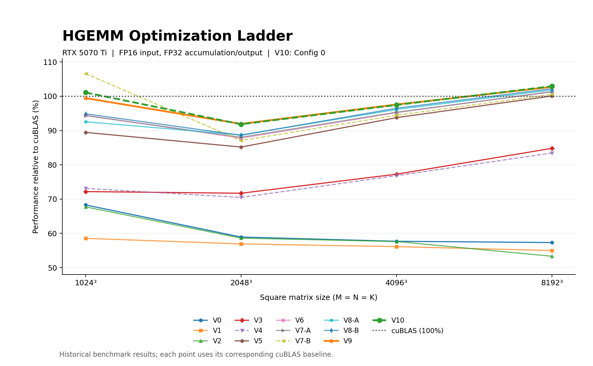

# CUDA — GPU 算子优化与 LLM 推理

基于 CUDA C++ 开展 GPU 高性能算子开发、性能分析及大语言模型推理工程实践。

项目围绕 GPU 硬件架构、并行计算、访存优化、Tensor Core、
异步流水线及推理系统展开，逐步实现从独立 CUDA 算子开发
到真实 LLM 推理系统集成的完整工程流程。

## 项目模块

| 项目 | 主要内容 | 状态 |
|---|---|---|
| [GEMM](operators/gemm/) | FP32 GEMM、Tensor Core HGEMM 深度优化 | 开发完成，待性能分析 |
| LLM Operators | RMSNorm、Softmax、RoPE、Attention 等算子 | 待开发 |
| MiniLLM-CUDA | LLM 推理流程与自研 CUDA 算子集成 | 待集成 |

## GEMM 深度优化

围绕矩阵乘法实现多阶段性能优化实验，
包括 GPU 硬件特性测试、分块计算、数据复用、
共享内存优化及 Tensor Core 计算。

### 实验内容

| 任务 | 内容 |
|---|---|
| [TASK0](operators/gemm/task0/) | GPU 理论计算性能分析 |
| [TASK1](operators/gemm/task1/) | 硬件延迟实验 |
| [TASK2](operators/gemm/task2/) | FMA 延迟与吞吐率实验 |
| [TASK3](operators/gemm/task3/) | Roofline 模型与分块参数分析 |
| [TASK4](operators/gemm/task4/) | FP32 GEMM 优化 |
| [TASK5](operators/gemm/task5/) | Tensor Core HGEMM 深度优化 |

### 核心优化技术

- Block / Warp / Thread 分块计算
- 寄存器分块与数据复用
- WMMA、mma.sync 与 ldmatrix
- cp.async 异步数据搬运
- 共享内存双缓冲与三缓冲
- Shared Memory Swizzle
- Block 同步优化
- 寄存器双缓冲
- 向量化访存
- 模板化 Kernel 与分块参数调优

### 性能成果

测试平台：NVIDIA RTX 5070 Ti。

| 项目 | 矩阵规模 | 最终性能 | 相对 cuBLAS |
|---|---|---:|---:|
| FP32 GEMM | 4096³ | 25.974 TFLOPS | 79.65% |
| HGEMM | 4096³ | 95.551 TFLOPS | 97.60% |
| HGEMM | 8192³ | 95.937 TFLOPS | 102.74% |
| HGEMM | 1024×2048×512 | 70.977 TFLOPS | 107.35% |

HGEMM 经过 V0～V10 共 13 个实验版本的迭代，
4096³ 矩阵吞吐率由 56.594 TFLOPS 提升至 95.551 TFLOPS，
加速比达到 1.688×。

详细实现、实验数据及优化分析见
[TASK5 README](operators/gemm/task5/README.md)。

## LLM Operators

面向大语言模型推理开发高性能 CUDA 算子。

计划实现：

| 算子 | 功能 |
|---|---|
| GEMM / GEMV | 线性层矩阵运算 |
| RMSNorm | 均方根归一化 |
| Softmax | 概率归一化 |
| RoPE | 旋转位置编码 |
| SwiGLU | 门控激活计算 |
| Attention | 注意力计算 |
| KV Cache | 键值缓存管理与相关算子 |

各算子独立进行正确性验证、性能测试及瓶颈分析，
并逐步集成至 MiniLLM-CUDA 推理项目。

## MiniLLM-CUDA

面向真实大语言模型的轻量级推理工程项目。

计划基于 Qwen2.5 模型实现推理流程，
逐步接入自行开发的 CUDA 算子，
研究模型推理中的计算、访存及调度优化。

主要开发方向：

- 模型权重加载与管理
- Tokenization 与自回归生成
- Prefill / Decode 推理流程
- KV Cache 管理
- CUDA 自定义算子集成
- 推理延迟、吞吐率及显存占用分析

## 技术栈

| 类别 | 技术 |
|---|---|
| 编程语言 | C++17、CUDA C++、Python |
| GPU 架构 | NVIDIA GPU |
| 开发工具 | CUDA Toolkit、NVCC、VS Code |
| 性能分析 | Nsight Compute、cuobjdump |
| 正确性验证 | cuBLAS、Compute Sanitizer |
| 推理框架 | PyTorch、Transformers（计划集成） |
| 工程管理 | Git、Makefile、Shell |

## 工程规范

- 统一正确性验证与 Benchmark 测试流程。
- 保留所有正式实验版本及性能数据。
- 通过同环境对照实验评价优化收益。
- 记录优化过程、资源限制及性能瓶颈。
- 支持开发环境自动化部署与实验复现。

## 项目进度

- [x] GPU 硬件特性实验
- [x] FP32 GEMM 优化
- [x] Tensor Core HGEMM 深度优化
- [x] 分块参数搜索
- [ ] GEMM 统一 Nsight Compute 性能分析
- [ ] LLM 核心算子开发
- [ ] MiniLLM-CUDA 推理系统集成
- [ ] 推理系统端到端性能优化
