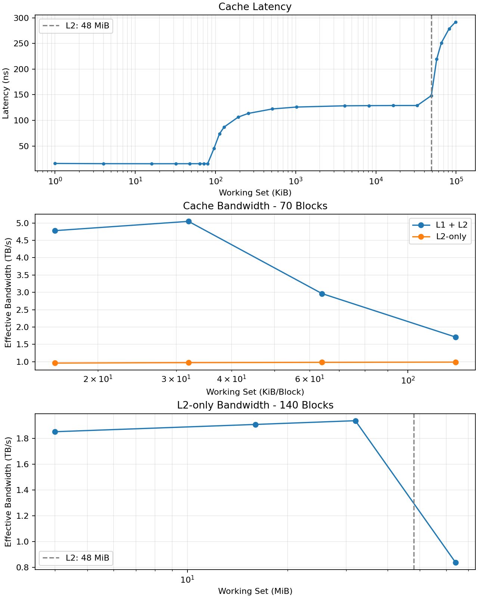

# TASK1：GPU 内存层次性能分析

## 1. 实验环境

| 项目 | 配置 |
|---|---|
| GPU | NVIDIA RTX 5070 Ti |
| CUDA Toolkit | 13.0 |
| GPU 架构 | sm_120 |
| SM 数量 | 70 |
| L2 Cache 容量 | 48 MiB |
| 理论显存带宽 | 896.06 GB/s |

## 2. 实验内容

本任务参考 MUSA Warmup Project，使用 CUDA C++ 测量 GPU 不同存储层次的访问延迟和读取带宽。

| 实验 | 测试方法 |
|---|---|
| Cache Latency | 随机指针追逐，测量缓存访问延迟 |
| Cache Bandwidth | 使用不同缓存策略，测量 L1/L2 有效读取带宽 |
| Shared Memory Latency | 使用 clock64() 测量串行共享内存访问延迟 |
| Shared Memory Bandwidth | 重复读取共享内存，测量并行读取吞吐量 |
| GDDR Bandwidth | 使用 float4 连续读取，测量显存带宽 |

## 3. 实验结果

### 3.1 访问延迟

| 存储层次 / 测试场景 | 实测延迟 |
|---|---|
| Shared Memory | 34 cycles/load |
| L1 Cache（小工作集） | 约 15.4 ns |
| L2 Cache（典型工作集） | 约 126–129 ns |
| 大工作集（96 MiB） | 291.82 ns |

Shared Memory 在 1–48 KiB 工作集下表现出稳定的访问延迟。

Cache Latency 在约 96 KiB 和 48 MiB 附近出现明显变化，反映了不同缓存层次的容量影响。

### 3.2 读取带宽

| 测试场景 | 有效读取带宽 |
|---|---|
| Shared Memory（64 KiB） | 6.149 TB/s |
| L1+L2（32 KiB/Block） | 5.046 TB/s |
| L2-only（32 MiB） | 1.939 TB/s |
| GDDR（4 GiB） | 0.836 TB/s |

共享内存带宽采用标量加载实现，并通过 Nsight Compute 验证实际访存指令数量。

### 3.3 缓存性能验证

Nsight Compute 测试结果：

| 指标 | 32 MiB | 64 MiB |
|---|---|---|
| L2 Hit Rate | 约 100% | 11.07% |
| DRAM Throughput | 84.71 GB/s | 697.95 GB/s |

工作集超过 48 MiB L2 Cache 容量后，缓存命中率明显下降，显存访问流量增加。

### 3.4 显存带宽

4 GiB 工作集测得有效读取带宽为 0.836 TB/s，约为理论显存带宽的 93.3%。

该比例基于程序逻辑读取量计算，不代表 NCU 实测的硬件带宽利用率。

## 4. 性能可视化

完整测试数据保存在 `results/out.log`。

## 5. 实验结论

1. GPU 不同存储层次具有明显的延迟和带宽差异。
2. 小工作集能够充分利用 L1/L2 Cache，获得较高的读取吞吐量。
3. 工作集超过 L2 Cache 容量后，访存性能受到显存带宽限制。
4. Shared Memory 的访问延迟在测试范围内基本稳定。
5. RTX 5070 Ti 在大工作集连续读取测试中达到约 0.836 TB/s 的有效显存带宽。

以上结果为当前 Kernel 和测试配置下的实测性能，不代表硬件理论峰值。
