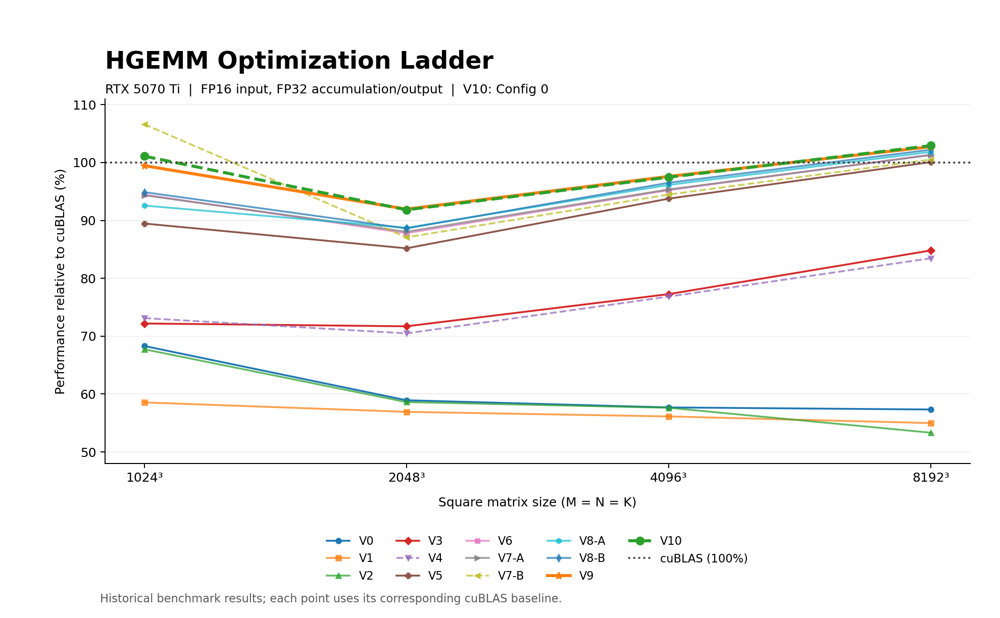

# TASK5 — Tensor Core HGEMM 深度优化

基于 CUDA C++ 实现 FP16 矩阵乘法与 FP32 累加，
通过分块计算、异步流水线、共享内存布局、
寄存器复用及向量化访存逐步优化 GEMM 性能。

## 实验环境

| 项目 | 配置 |
|---|---|
| GPU | NVIDIA RTX 5070 Ti |
| 架构 | Blackwell SM120 |
| SM 数量 | 70 |
| CUDA Toolkit | 13.0 |
| 输入精度 | FP16 |
| 累加 / 输出精度 | FP32 |
| 性能基准 | cuBLAS GemmEx |

## 优化路线

| 版本 | 核心优化 | 实验结论 |
|---|---|---|
| V0 | WMMA 基础实现 | 建立性能基线 |
| V1 | mma.sync 显式矩阵乘加 | 性能略有下降 |
| V2 | ldmatrix 矩阵加载 | 减少手动加载及打包操作 |
| V3 | 增大分块与异步双缓冲 | 性能提升 34.62% |
| V4 | 共享内存三缓冲 | 性能下降，未采用 |
| V5 | 共享内存 XOR Swizzle | 性能提升 21.32% |
| V6 | 改进 A 矩阵 Swizzle | 性能提升 1.61% |
| V7-A | 双缓冲单同步 | 同步次数减半 |
| V7-B | 三缓冲单同步 | 无额外收益，未采用 |
| V8-A | B 矩阵加载指令合并 | 矩阵加载指令减少 25% |
| V8-B | B 寄存器双缓冲 | 寄存器数量降低，性能小幅提升 |
| V9 | float2 向量化写回 | 静态写回指令减少 50% |
| V10 | 模板化与分块参数调优 | 支持六种分块配置 |

性能提升比例采用 4096³ 同环境对照实验结果。

## 性能演进

各曲线表示对应版本在不同方阵规模下相对于同轮默认
cuBLAS 的性能百分比，V10 采用 Config 0。

### 不同矩阵规模吞吐率

单位：TFLOPS。

| 版本 | 1024³ | 2048³ | 4096³ | 8192³ | 非方阵 |
|---|---:|---:|---:|---:|---:|
| V0 | 47.696 | 55.373 | 56.594 | 53.020 | 46.330 |
| V1 | 40.995 | 53.495 | 55.010 | 50.889 | 42.501 |
| V2 | 46.266 | 55.086 | 56.525 | 49.405 | 43.991 |
| V3 | 49.895 | 67.395 | 76.099 | 78.787 | 50.898 |
| V4 | 48.489 | 66.211 | 75.251 | 77.916 | 50.725 |
| V5 | 59.179 | 80.034 | 91.833 | 93.503 | 57.753 |
| V6 | 62.514 | 82.059 | 93.283 | 94.618 | 58.610 |
| V7-A | 62.748 | 82.697 | 93.306 | 94.480 | 61.966 |
| V7-B | 62.427 | 81.815 | 92.545 | 93.698 | 60.815 |
| V8-A | 62.777 | 83.339 | 93.867 | 95.045 | 62.572 |
| V8-B | 62.983 | 83.249 | 94.269 | 95.430 | 61.966 |
| V9 | 65.922 | 86.251 | 95.551 | 95.937 | 70.977 |
| V10 | 67.109 | 86.258 | 95.161 | 95.488 | 70.345 |

非方阵规模：1024×2048×512。

V10 采用 Config 0 的正式参数搜索结果。

### 4096³ 性能对照

| 版本 | 耗时（ms） | TFLOPS | 相对 cuBLAS | 加速比 |
|---|---:|---:|---:|---:|
| V0 | 2.429 | 56.594 | 57.69% | 1.000× |
| V1 | 2.498 | 55.010 | 56.13% | 0.972× |
| V2 | 2.431 | 56.525 | 57.63% | 0.999× |
| V3 | 1.806 | 76.099 | 77.26% | 1.345× |
| V4 | 1.826 | 75.251 | 76.84% | 1.330× |
| V5 | 1.497 | 91.833 | 93.76% | 1.623× |
| V6 | 1.473 | 93.283 | 95.23% | 1.648× |
| V7-A | 1.473 | 93.306 | 95.34% | 1.649× |
| V7-B | 1.485 | 92.545 | 94.47% | 1.635× |
| V8-A | 1.464 | 93.867 | 96.13% | 1.659× |
| V8-B | 1.458 | 94.269 | 96.51% | 1.666× |
| V9 | 1.438 | 95.551 | 97.60% | 1.688× |
| V10 | 1.444 | 95.161 | 97.47% | 1.681× |

加速比以 V0 为基准。

## 分块参数搜索

固定 Warp Tile 为 64×32，测试六种 Block Tile 配置。

单位：TFLOPS。

| Config | BM×BN×BK | 理论占用率 | 1024³ | 2048³ | 4096³ | 8192³ | 非方阵 |
|---|---|---:|---:|---:|---:|---:|---:|
| 0 | 128×128×32 | 33.33% | 67.109 | 86.258 | 95.161 | 95.488 | 70.345 |
| 1 | 128×256×32 | 33.33% | 37.904 | 78.992 | 81.117 | 86.992 | 66.975 |
| 2 | 256×128×32 | 33.33% | 37.947 | 79.307 | 81.080 | 87.067 | 65.825 |
| 3 | 128×64×64 | 16.67% | 71.279 | 84.834 | 91.844 | 90.482 | 71.203 |
| 4 | 64×128×64 | 16.67% | 71.545 | 85.380 | 92.336 | 82.608 | 71.128 |
| 5 | 128×128×64 | 16.67% | 71.583 | 79.731 | 87.072 | 89.077 | 62.660 |

30 组参数搜索及 24 组稳定性复测全部通过正确性验证。

最终配置选择：

- Config 0：中、大规模方阵的默认配置。
- Config 4：小规模矩阵候选配置。
- 1024³ 三轮复测中，Config 4 中位数达到 71.659 TFLOPS，
  相比 Config 0 提升 6.89%。
- 非方阵中 Config 0、3、4 性能基本持平。

## 瓶颈判断与优化分析

| 优化方向 | 判断过程与实验结论 |
|---|---|
| 数据复用 | 增大分块可以提高算术强度，但需要平衡寄存器、共享内存及任务并行度。 |
| 异步流水线 | 双缓冲与增大分块取得明显收益，三缓冲未表现出额外性能优势。 |
| Bank Conflict | 根据 ldmatrix 地址映射改进共享内存布局，Swizzle 取得显著性能收益。 |
| Block 同步 | 删除冗余同步，每个 phase 的同步次数由 2 次减至 1 次。 |
| 矩阵加载 | 合并 B 矩阵加载，每 Warp 每 phase 的 ldmatrix 指令由 16 条减至 12 条。 |
| 寄存器流水线 | 引入 B 寄存器双缓冲，实际寄存器数量由 126 降至 123。 |
| 全局内存写回 | 使用 float2，SASS 写回指令由 64 条 STG.E 减至 32 条 STG.E.64。 |
| 任务并行度 | 1024³ 下，128×256 分块仅产生 32 个 Block，无法覆盖全部 70 个 SM。 |
| 资源限制 | BK 增大可能降低理论驻留 Warp 数量，减少同步不一定提高整体性能。 |

## 当前成果

| 指标 | 结果 |
|---|---:|
| 4096³ 吞吐率 | 95.551 TFLOPS |
| 4096³ 相对 cuBLAS | 97.60% |
| 8192³ 吞吐率 | 95.937 TFLOPS |
| 8192³ 相对 cuBLAS | 102.74% |
| 非方阵吞吐率 | 70.977 TFLOPS |
| 非方阵相对 cuBLAS | 107.35% |
| 相比 V0 加速比（4096³） | 1.688× |
| 相比 V0 吞吐率提升 | 68.83% |

以上采用 V9 的正式对照复测结果。

## 测试方法

- 固定随机种子，使用 cuBLAS 进行全元素正确性验证。
- CUDA Event 计时，预热 10 次，重复 20 次，共 3 轮，取中位数。
- Compute Sanitizer 检查内存访问及共享内存竞争。
- cuobjdump 检查编译资源与 SASS 指令。
- 优化收益优先依据同环境对照实验判断。
- 所有正式实验版本均保留源码。

## 项目总结

本项目基于 NVIDIA RTX 5070 Ti，完成了从 WMMA 基础实现
到显式 MMA 指令、异步流水线、共享内存布局优化、
寄存器双缓冲、向量化写回及模板化分块调优的完整 GEMM 优化过程。

经过 V0～V10 共 13 个实验版本的迭代，
在 4096³ 矩阵规模下，计算吞吐率由 56.594 TFLOPS
提升至 95.551 TFLOPS，加速比达到 1.688×，
达到同轮 cuBLAS 性能的 97.60%。
在 8192³ 和 1024×2048×512 规模下，
分别达到同轮 cuBLAS 性能的 102.74% 和 107.35%。

实验表明，GEMM 性能优化需要综合平衡数据复用率、
访存效率、指令调度、寄存器压力、共享内存占用及任务并行度，
而非单纯增加分块大小、流水线深度或理论占用率。

最终实现六种可配置的 GEMM Kernel，
保留全部正式实验源码及性能记录。

